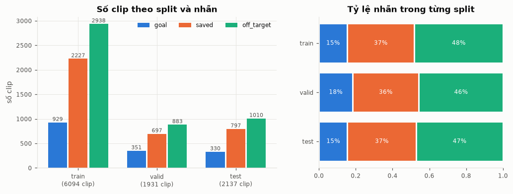
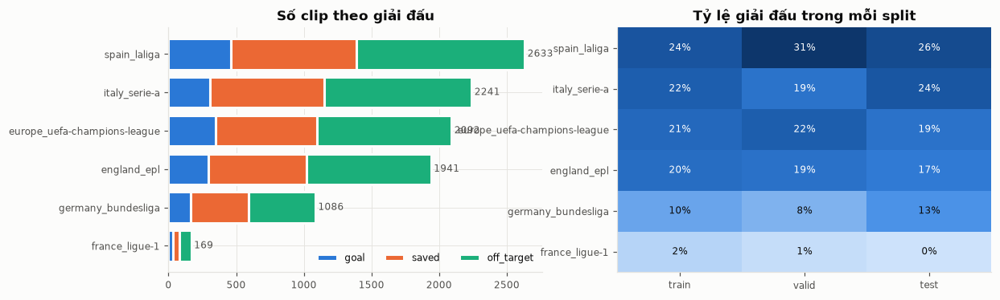
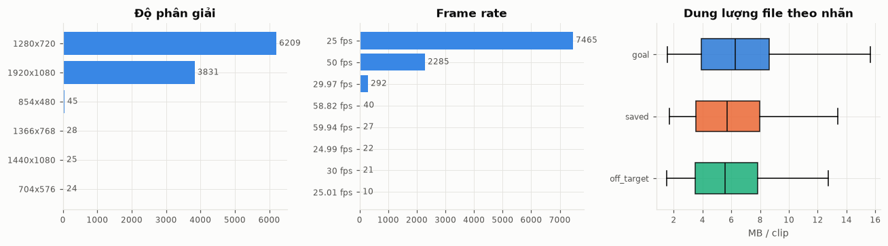
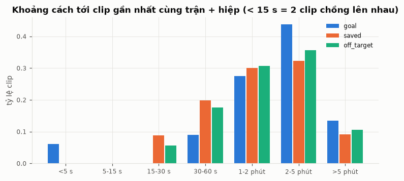
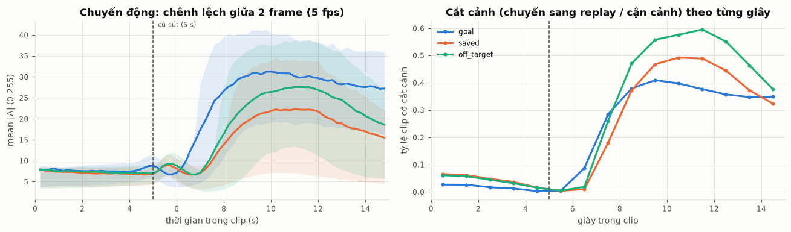
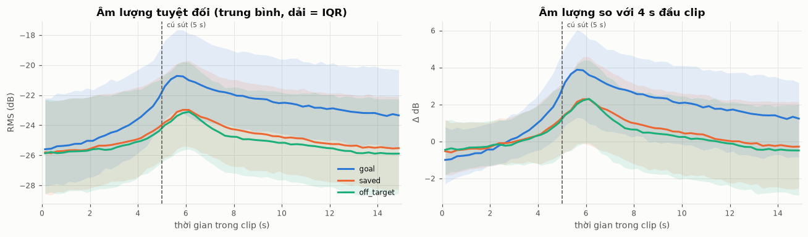
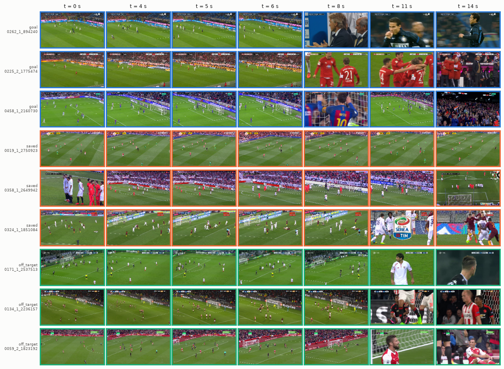
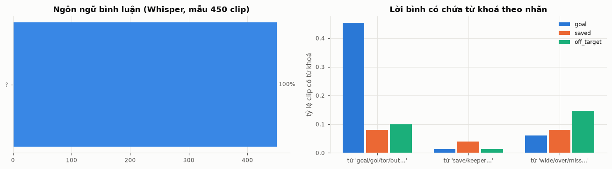

# Phân tích dữ liệu SoccerNet shots (clip 15 s): goal / saved / off_target

Nguồn: `/data/Cuong/pickleball/data/bendmark/football` (part1 = valid, part2 = test, part3–6 = train).
Script: `baseline/football/analyze_dataset.py` (đo từng clip bằng ffprobe/ffmpeg, Whisper trên mẫu 450 clip).
Số liệu thô: `stats.json`, từng clip: `baseline/football/outputs/analysis/per_clip.csv`.

## 1. Quy mô và chia tập

| Split | Trận | goal | saved | off_target | Tổng |
|---|---|---|---|---|---|
| train (part3–6) | 281 | 929 (15%) | 2 227 (37%) | 2 938 (48%) | 6 094 |
| valid (part1) | 92 | 351 (18%) | 697 (36%) | 883 (46%) | 1 931 |
| test (part2) | 98 | 330 (15%) | 797 (37%) | 1 010 (47%) | 2 137 |

- Manifest có 10 165 dòng, trong đó 3 dòng `failed:` không có clip. Cả 10 162 clip còn lại đều có file.
- Không trận nào nằm ở hai split, nên không bị rò rỉ dữ liệu theo trận. Tỷ lệ nhãn giữa ba split gần như nhau.
- Lệch lớp vừa phải: goal chỉ chiếm khoảng 15–18%. Vì vậy chỉ số chính là **macro-F1**.
- Giải đấu: La Liga 2 633, Serie A 2 241, Champions League 2 092, EPL 1 941, Bundesliga 1 086, Ligue 1 169. Mùa 2014–2017 (fig03).

## 2. Chất lượng video và âm thanh

- Mọi clip đều dài đúng 15,0 s và đều có âm thanh.
- Độ phân giải chủ yếu là 1280x720 (61%) và 1920x1080 (38%).
- Có nhiều fps khác nhau: 25 fps (73%), 50 fps (22%), cùng 29,97/30/59,94. Vì vậy feature được lấy mẫu theo **thời gian**, không theo số frame.
- `visibility` = visible ở 100% clip và `video_res` = HQ ở khoảng 99% clip, nên hai cột này không mang thông tin (fig04).
- `chain_len`: 96% chuỗi saved/off_target chỉ có 1 cú sút.

## 3. Clip trùng / chồng nhau

- 6,2% clip goal có một clip goal khác cách < 15 s trong cùng hiệp. Nguyên nhân là SoccerNet gắn nhãn Goal hai lần (bàn thắng và replay). Có 245 clip goal có clip goal khác trong vòng 60 s.
- Saved/off_target không có clip chồng nhau, theo quy tắc gộp chuỗi 15 s.
- Các cặp trùng luôn nằm cùng một trận, nên cùng split. Chúng chỉ làm tăng trọng số của một số bàn thắng, không làm rò rỉ sang test.

## 4. Tín hiệu theo thời gian (cú sút ở giây 5)

- **Chuyển động (fig09, trái):** trước giây 5, ba lớp giống nhau. Từ khoảng giây 6,5, clip **goal** có chuyển động mạnh nhất (ăn mừng, máy quay lia nhanh). Off_target đứng giữa, saved thấp nhất. Thông tin phân biệt nằm ở khoảng **6–12 s**.
- **Cắt cảnh (fig09, phải):** sau cú sút, 60–87% clip chuyển sang replay hoặc cận cảnh. Off_target bị cắt cảnh nhiều nhất (87% clip có cắt cảnh ở 10–15 s). Goal bị cắt ít hơn ở 10–15 s vì máy quay bám theo màn ăn mừng.
- **Âm thanh (fig08):** cả ba lớp đều to lên quanh cú sút (+5 dB). Goal to hơn khoảng 2 dB và giữ mức cao lâu hơn. Saved và off_target gần như trùng nhau.

## 5. Lời bình luận

- Toàn bộ 10162 clip đã được Whisper large-v3-turbo chép lời (`transcribe.py`); 9628 clip (≈95%) có lời bình ≥ 2 từ.
- Ngôn ngữ (toàn bộ dữ liệu): Tây Ban Nha 3226, Anh 3006, Nga 2171, Đức 1245, Pháp 388, Ý 56, Thổ Nhĩ Kỳ 55, còn lại < 10 clip.
- Từ "goal / gol / golazo / tor / but / гол" trên toàn bộ dữ liệu: **43%** clip goal, 9% clip saved, 11% clip off_target (mẫu 450 clip trước đó cho 45% / 8–10%, khớp).
- Như vậy lời bình là một tín hiệu mạnh cho v4/v5 (nhánh text). Đây là đầu vào hợp lệ, vì là âm thanh của chính clip chứ không phải nhãn.
- Ghi chú: fig12 được vẽ trên mẫu 450 clip; cột ngôn ngữ trong hình có thể hiện `?` (lỗi của bản Whisper mới, đã sửa trong `transcribe.py` bằng `detect_language`). Số liệu ngôn ngữ ở trên là số đúng trên toàn bộ dữ liệu.

## 6. Mốc dễ / khó

Logistic regression trên đặc trưng thô (không dùng deep model), train → valid macro-F1:

| Đặc trưng | macro-F1 |
|---|---|
| Âm lượng theo giây | 0,391 |
| Cắt cảnh theo giây | 0,404 |
| Chuyển động theo giây | 0,519 |
| Cả ba | **0,544** |

Kết luận cho mô hình:
1. **goal** là lớp dễ nhất, nhờ ăn mừng, âm thanh to và lời bình.
2. **saved ↔ off_target** là cặp khó: âm thanh gần như giống nhau, khác biệt chủ yếu nằm ở hình ảnh ngay sau cú sút (thủ môn bắt bóng, bóng đi ra ngoài) và ở cách cắt cảnh.
3. Nên tập trung vào khoảng 3–11 s: các view `focus` lấy 32 frame trong đoạn này (dày gấp đôi view cả clip).
4. Lời bình đa ngôn ngữ; đã thử cả multilingual CLIP text (`--text asr_mclip`) và CLIP text tiếng Anh (`--text asr`). Trên valid hai cách gần như ngang nhau (0,7868 vs 0,7882), nên benchmark chọn `asr` (xem `results/RESULTS.md`).
