# Phân tích bộ dữ liệu SoccerNet Shots

Dữ liệu: `/data/Cuong/pickleball/data/bendmark/football/soccernet_shots` (`manifest_clean.csv`, 10 679 clip, 471 trận).
Script tạo lại toàn bộ biểu đồ và số liệu: [`../analyze_soccernet_shots.py`](../analyze_soccernet_shots.py). Số liệu thô nằm trong `stats.json`.

Phần nội dung hình và tiếng (mục 5) chạy trên **mẫu 900 clip** (300 clip mỗi lớp, chọn ngẫu nhiên với seed 0). Các phần còn lại dùng toàn bộ 10 679 clip.

## Tóm tắt

1. **Khoảng 125 nhãn goal (7,4% số clip goal) nhiều khả năng bị gán sai.** Có 125 clip goal nằm cách một clip goal khác dưới 5 giây trong cùng hiệp, và 97 trận có nhiều nhãn goal hơn số bàn trong tỉ số chung cuộc. Nguyên nhân là luật gán nhãn: cú sút trúng đích có nhãn `Goal` của SoccerNet trong vòng 5 giây sau thì được tính là goal. Khi thủ môn cản phá rồi cầu thủ khác đá bồi thành bàn, cả cú sút bị cản phá cũng bị gán goal. Ví dụ: trận 6, phút 28, caption ghi "Asmir Begovic makes a superb save…" nhưng nhãn lại là goal. Số clip này có ở cả ba split: train 68, valid 28, test 29.
2. **Caption làm lộ kết quả rất nhiều.** Chỉ cần bắt từ khóa ("Goal!", tỉ số `2:1`, "save", "wide"…) là đã đoán được 46% số clip, với độ chính xác 82% cho 3 lớp và 94% cho hit/miss. F1 của lớp hit khi chỉ dùng luật này là **0,61 trên test**, không cần học gì. Mọi mô hình có dùng text nên được so với mức này.
3. **Trước cú sút, hình và tiếng gần như không phân biệt được goal với miss.** Các đặc trưng đơn giản đo trong 6 giây trước cú sút có AUC 0,46–0,56. Sau cú sút, tín hiệu tách rõ hơn: độ ồn tăng +2,6 dB ở bàn thắng so với +1,0 dB ở cú sút hỏng (AUC 0,68), chuyển động mạnh hơn (AUC 0,63), và khung hình bớt mặt cỏ, tức là chuyển sang cận cảnh (AUC 0,61 nếu đảo chiều). Nghĩa là mô hình chủ yếu học được phản ứng sau cú sút: tiếng reo hò và cảnh ăn mừng.
4. **Thông số kỹ thuật không đồng nhất như README mô tả.** 61% clip là 1280×720 (kể cả 6 363 clip được đánh dấu `HQ`). Có 2 392 clip ở 50 fps và 303 clip ở 29,97 fps. 882 clip có audio 6 kênh, 631 clip có tần số mẫu khác 48 kHz. Riêng **2 clip bị cắt ngắn** (2,9 s và 5,7 s), không chứa thời điểm sút, và **2 clip không có audio**.
5. **Phân bố nhãn ổn định giữa các split**: goal 15–18%, saved 38%, off_target 44–47%. Không có lệch lớn theo giải đấu, đội nhà/khách hay mùa giải.

## 1. Phân bố nhãn

| Lớp | Số clip | Tỉ lệ |
|---|--:|--:|
| goal (hit) | 1 683 | 15,8% |
| saved | 4 050 | 37,9% |
| off_target | 4 946 | 46,3% |

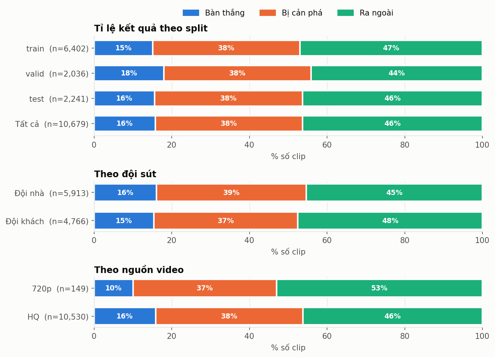

- Tỉ lệ goal theo split: train 15%, valid 18%, test 16%. Valid có nhiều goal hơn một chút; nếu chọn ngưỡng quyết định trên valid thì nên lưu ý điểm này.
- Đội nhà và đội khách gần như giống nhau (16% so với 15% goal). Đội nhà sút nhiều hơn: 5 913 so với 4 766 cú.
- 149 clip lấy từ bản 720p có tỉ lệ goal thấp hơn (10%), nhưng mẫu nhỏ nên không đáng lo.

## 2. Giải đấu và mùa giải

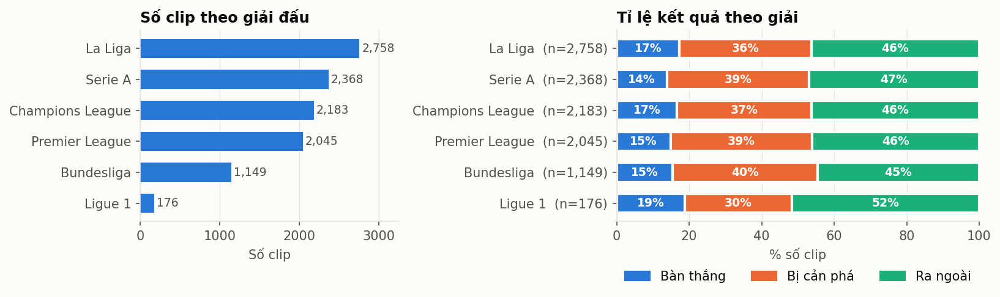
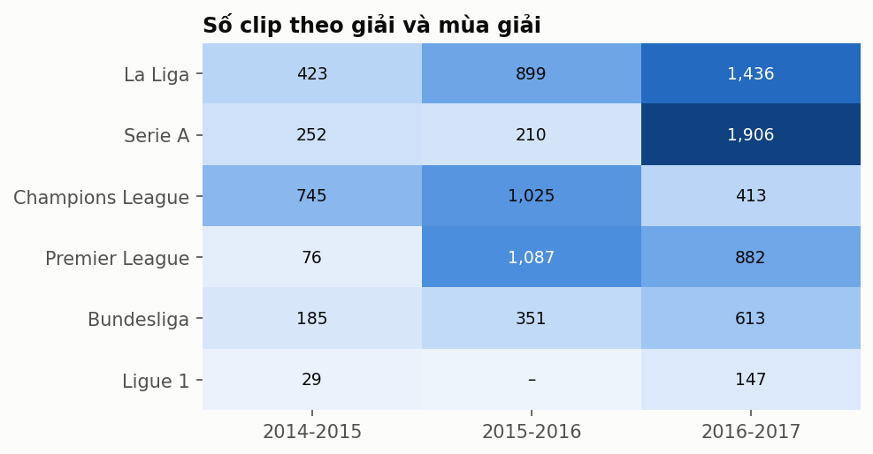

- La Liga, Serie A, Champions League và Premier League chiếm 87% số clip. Ligue 1 chỉ có 176 clip (1,6%).
- Tỉ lệ goal dao động từ 13,9% (Serie A) đến 17,3% (La Liga). Ligue 1 là 18,8%, nhưng mẫu nhỏ.
- Mùa 2016-17 chiếm một nửa dữ liệu (5 397 clip). Mùa 2014-15 chỉ có 1 710 clip.

## 3. Thời điểm sút trong trận

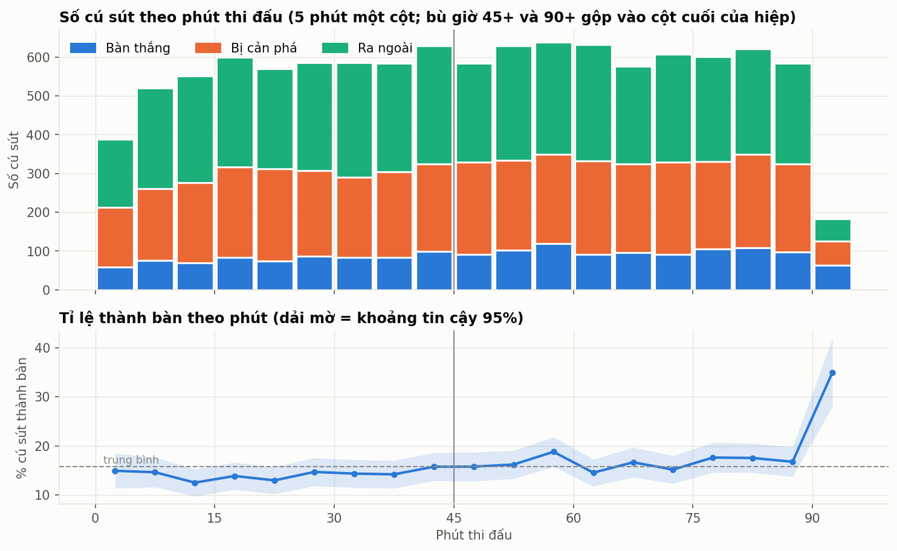

- Hiệp 2 có nhiều cú sút hơn hiệp 1 (5 662 so với 5 017). Tỉ lệ thành bàn ở hiệp 2 cũng nhỉnh hơn một chút (khoảng 16–18% so với 13–15%).
- Cột bù giờ 90+ có tỉ lệ goal 35%, cao gấp đôi mức trung bình. Một phần là do bóng đá thật (các đội dồn lên tấn công cuối trận). Một phần có thể do nhãn goal bị lặp như ở mục 4. Mô hình không nên được nhìn thấy thời điểm trận đấu (đồng hồ trên màn hình), vì đây là một tín hiệu "tắt".

## 4. Chất lượng nhãn theo trận

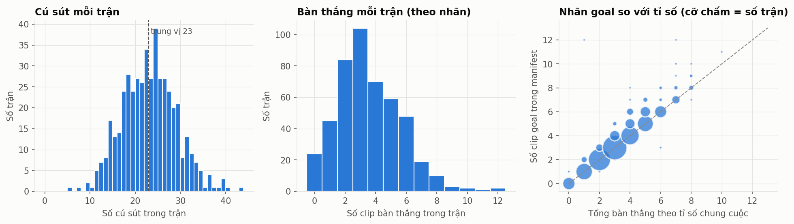
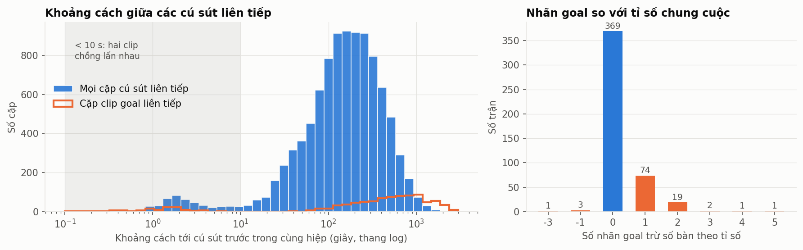

- Trung vị là 23 cú sút mỗi trận, ít nhất 5, nhiều nhất 43.
- So số nhãn goal với tỉ số chung cuộc trong tên trận: 369/470 trận khớp. **97 trận có nhiều nhãn goal hơn số bàn thật**, tổng cộng thừa khoảng 127 nhãn. Chỉ có 4 trận thiếu nhãn.
- Đường màu cam ở biểu đồ trái cho thấy một cụm cặp clip goal cách nhau 1–4 giây. Hai bàn thắng thật không thể cách nhau ngắn như vậy, vì sau mỗi bàn phải giao bóng lại. Đây là 125 nhãn goal bị lặp.
- Trận 387 (Real Madrid – Rayo Vallecano, 20/12/2015) có 12 nhãn goal, trong khi tên thư mục SoccerNet ghi tỉ số `1 - 0`. Thực tế trận này kết thúc 10–2, nên lỗi nằm ở tên thư mục chứ không phải ở nhãn. Trận này được loại khỏi biểu đồ so sánh.
- **485 cặp cú sút cách nhau dưới 10 giây** trong cùng hiệp, liên quan tới 950 clip. Vì mỗi clip dài 10 giây, các clip này có hình ảnh chồng lấn nhau. Do cùng một trận luôn nằm trong cùng một split, việc chồng lấn không làm rò dữ liệu giữa train và test, nhưng làm số mẫu độc lập ít hơn con số 10 679.

**Đề xuất sửa:** trong mỗi nhóm clip goal cách nhau dưới 5 giây, chỉ giữ clip cuối cùng là goal, các clip trước đổi thành `saved`. Cách tốt hơn là đọc caption hoặc xem video để quyết định. Danh sách các clip này nằm trong `stats.json → quality.dup_goal_examples` và có thể tái tạo từ `cache/shot_gaps.csv`.

## 5. Caption

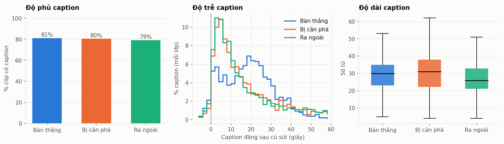

- Độ phủ caption gần như bằng nhau giữa các lớp (79–81%), nên việc *có hay không có* caption không làm lộ nhãn.
- Caption được đăng sau cú sút với trung vị 11,9 giây (10% đầu ở 2 giây, 10% cuối ở 38,5 giây). **Caption của bàn thắng đăng muộn hơn hẳn**, đỉnh ở khoảng 18–25 giây, vì trang tường thuật thường chờ hết pha ăn mừng và chiếu lại. Ngay cả độ trễ cũng là một tín hiệu lộ nhãn, nên không nên đưa `caption_offset_s` vào mô hình.
- Độ dài caption tương đương nhau (trung vị 26–31 từ).

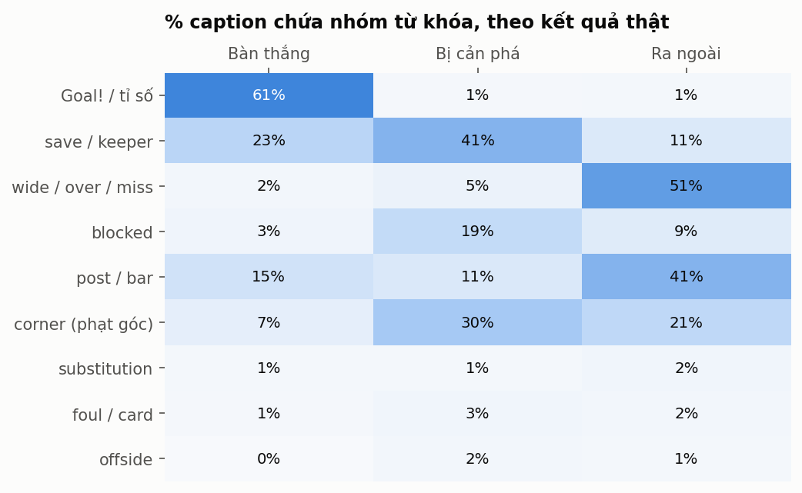
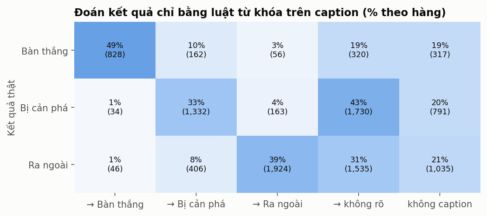
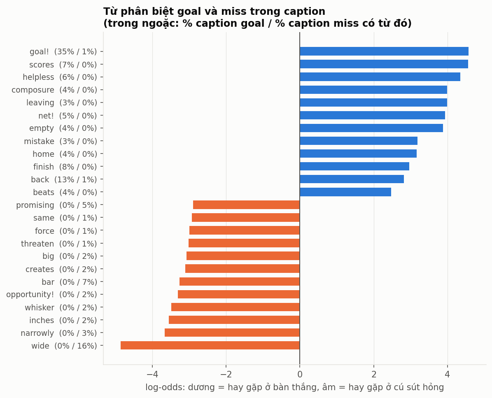

- 61% caption của clip goal chứa "Goal!" hoặc tỉ số kiểu `1:0`. Với hai lớp miss, tỉ lệ này chỉ khoảng 1%.
- Các từ gần như chỉ xuất hiện ở một phía: "goal!", "scores", "helpless", "net!", "empty" cho bàn thắng; "wide", "narrowly", "inches", "whisker", "bar" cho cú sút hỏng.
- Luật từ khóa đơn giản (không học) đạt độ chính xác 91% với lớp goal và tìm ra 49% số bàn thắng, cho F1 hit là 0,64 trên toàn bộ dữ liệu (test 0,61).
- 23% caption của clip goal lại chứa "save/keeper". Đây chính là các clip goal bị gán sai ở mục 4, cộng với các caption mô tả pha khác.

## 6. Thông số kỹ thuật (ffprobe trên cả 10 679 clip)

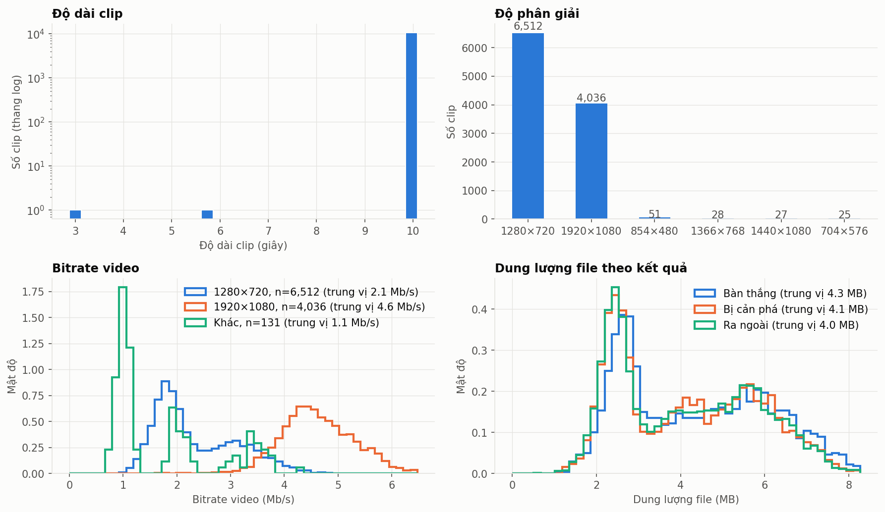

| Thuộc tính | Giá trị |
|---|---|
| Codec | Video HEVC 100%, audio AAC (trừ 2 clip không có audio) |
| Độ phân giải | 1280×720: 6 512 · 1920×1080: 4 036 · 854×480: 51 · 1366×768: 28 · 1440×1080: 27 · 704×576: 25 |
| fps | 25: 7 856 · 50: 2 392 · 29,97: 303 · khác (59,94, 58,8, 30…): 128 |
| Audio | 48 kHz: 10 046 · 44,1 kHz: 607 · 22,05 kHz: 24; stereo 9 795 · 5.1 kênh 882 |
| Bitrate video (trung vị) | 720p 2,1 Mb/s · 1080p 4,6 Mb/s |
| Dung lượng | trung vị 4,1 MB/clip, tổng 44,8 GB |
| Độ dài | 10 677 clip dài 10,0 s; **2 clip bị ngắn** |

**Clip lỗi nên loại:**

| Clip | Vấn đề |
|---|---|
| `clips/train/0135_2_798120.mp4` | Chỉ dài 2,9 s, không có thời điểm sút |
| `clips/train/0139_1_1527803.mp4` | Chỉ dài 5,7 s, không có thời điểm sút |
| `clips/train/0447_1_2599800.mp4` | Không có audio |
| `clips/train/0447_1_2607950.mp4` | Không có audio |

Khi nạp dữ liệu nên chuẩn hóa: lấy mẫu frame theo thời gian (giây) chứ không theo chỉ số frame, vì fps khác nhau; và downmix audio về mono 16 kHz như README hướng dẫn. Dung lượng file của clip goal nhỉnh hơn một chút (trung vị 4,3 MB so với 4,0–4,1 MB), vì cảnh ăn mừng có nhiều chuyển động hơn nên khó nén hơn.

## 7. Nội dung hình và tiếng quanh cú sút (OpenCV + numpy, 900 clip)

Cách đo, mỗi giá trị lấy theo 12,5 frame/giây, ảnh được thu nhỏ còn 192×108:

- **Chuyển động**: chênh lệch trung bình giữa hai frame xám liên tiếp
- **Cắt cảnh**: khoảng cách Bhattacharyya giữa histogram HSV của hai frame liên tiếp lớn hơn 0,45 (đây là cách ước lượng thô)
- **Tỉ lệ mặt cỏ**: tỉ lệ điểm ảnh màu xanh lá trong HSV (H 32–88, S ≥ 50, V ≥ 40). Tỉ lệ cao là cảnh toàn sân, thấp là cảnh cận hoặc khán đài
- **Độ ồn**: RMS (dB) theo cửa sổ 0,1 giây, trừ đi trung vị của 5 giây đầu clip để bỏ chênh lệch âm lượng giữa các đài
- **Độ phẳng phổ**: cao nghĩa là âm thanh giống tiếng ồn (đám đông), thấp nghĩa là có cao độ rõ (giọng nói)

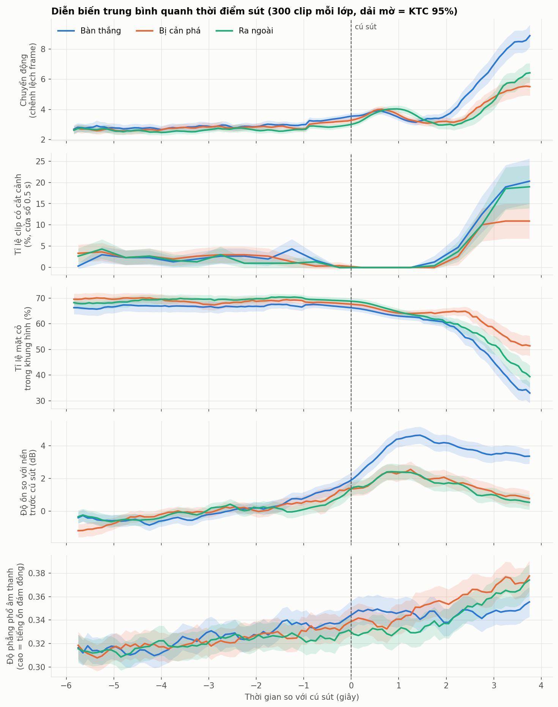
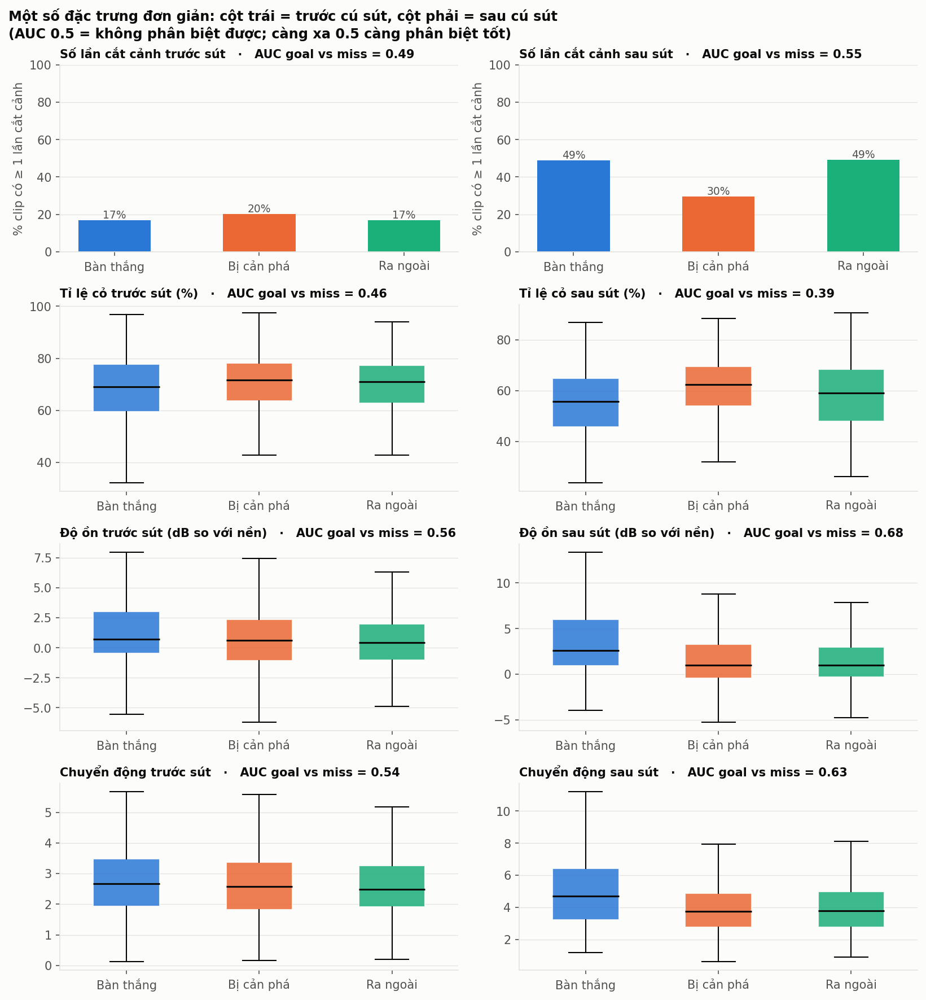

| Đặc trưng | AUC goal vs miss, trước sút | AUC goal vs miss, sau sút |
|---|--:|--:|
| Độ ồn so với nền | 0,56 | **0,68** |
| Chuyển động | 0,54 | **0,63** |
| Tỉ lệ mặt cỏ | 0,46 | **0,39** (tức 0,61 nếu đảo chiều) |
| Số lần cắt cảnh | 0,49 | 0,55 |

Nhận xét:

- **Trong 6 giây trước cú sút, ba lớp gần như trùng nhau.** Đường trung bình của cả 5 tín hiệu chồng lên nhau đến khoảng −1 giây. Khoảng −1 đến 0 giây, độ ồn ở clip goal bắt đầu nhích lên. Nhiều khả năng đây là do mốc nhãn lệch khoảng 1 giây (README đã nêu) chứ không phải tín hiệu dự đoán thật.
- **Độ ồn là tín hiệu "tắt" mạnh nhất.** Sau bàn thắng, độ ồn tăng khoảng 4,5 dB tại +1,5 giây và giữ ở mức đó. Với cú sút hỏng, độ ồn chỉ tăng khoảng 2,3 dB rồi giảm dần.
- **Hình ảnh thay đổi từ khoảng +2 giây.** Ở clip goal, tỉ lệ mặt cỏ giảm từ 66% xuống 33% (camera chuyển sang cận cảnh cầu thủ ăn mừng) và chuyển động tăng gấp ba. Clip off_target cũng có xu hướng tương tự nhưng yếu hơn (cận cảnh cầu thủ tiếc nuối). Clip saved là lớp giữ cảnh toàn sân lâu nhất. Ảnh ghép bên dưới minh họa rõ điều này.
- Khoảng 49% clip goal và off_target có ít nhất một lần cắt cảnh sau cú sút, so với 30% ở clip saved. Trước cú sút, con số này chỉ khoảng 17–20% ở cả ba lớp.

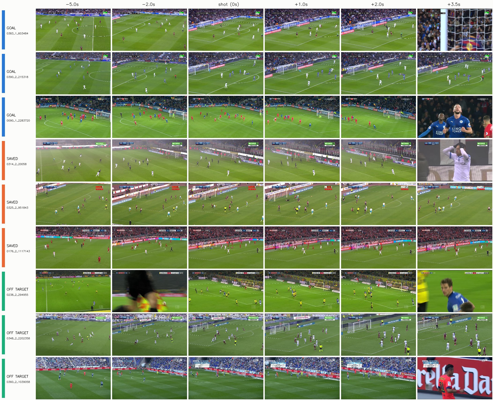

## 8. Khuyến nghị cho benchmark

1. **Sửa nhãn goal bị lặp** (125 clip) trước khi báo cáo kết quả. Ít nhất cũng nên báo cáo thêm kết quả trên tập test đã bỏ các clip này.
2. **Loại 4 clip lỗi** ở mục 6.
3. **Luôn kèm baseline luật từ khóa** (F1 hit 0,61 trên test) khi báo cáo các cấu hình có text. Nên chạy thêm cấu hình dùng caption đã che các từ chỉ kết quả ("Goal!", tỉ số, save, wide…).
4. **Chạy thêm cấu hình chỉ dùng phần trước cú sút** (`--post 0`), hoặc ít nhất cắt bỏ từ +1,5 giây trở đi. Phân tích ở mục 7 cho thấy phần lớn tín hiệu phân biệt nằm sau cú sút, chủ yếu là tiếng reo hò và cảnh cận.
5. **Không dùng `caption_offset_s` và thời điểm trận đấu làm đặc trưng.** Cả hai đều mang thông tin về nhãn.
6. **Báo cáo F1/AUC/balanced accuracy**, vì goal chỉ chiếm 15,8%.
