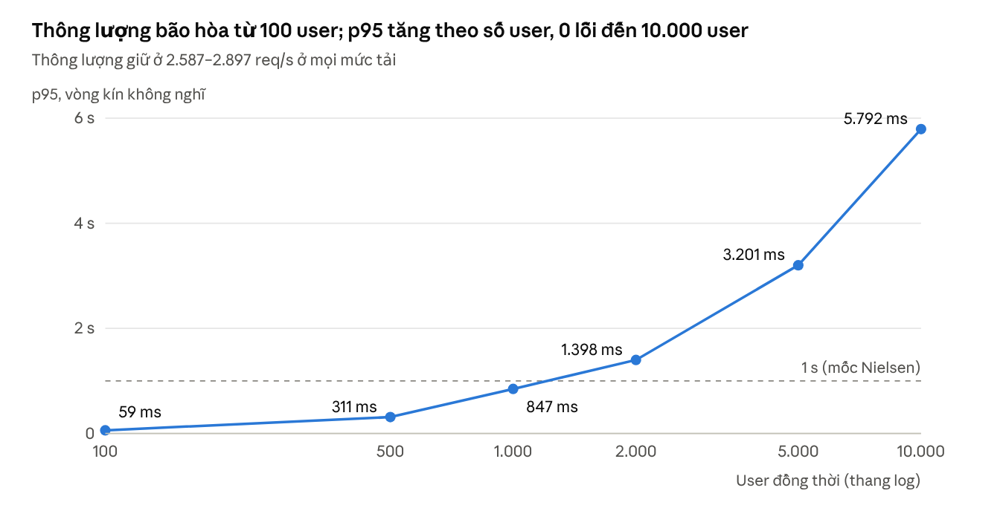

# Đánh giá hiệu năng hệ thống chấm điểm video HaUI Fitness

28/10/2026

## 1. Tóm tắt

Trên một máy chủ duy nhất (48 luồng CPU, 1 GPU A30), hệ thống chấm điểm video HaUI Fitness đạt các mức sau:

- phục vụ 10.000 user vòng kín không lỗi, đỉnh 2.897 req/s;

- trả điểm video ngắn sau 2,6 s và video 60 s sau 60,6 s;

- chấm hết 1.000 bài nộp dồn cùng lúc trong 10,7 phút.

Hệ thống không sập ở bất kỳ mức tải nào. Nút thắt của việc chấm là giải mã video trên CPU, chiếm 86% thời gian, trong khi GPU chỉ dùng trung bình 12–22%.

Bộ kiểm thử gồm 5 giai đoạn và hơn 60 bài, dùng JMeter 5.6.3 và một bộ mô phỏng người dùng. Mọi số liệu đều lấy từ lần chạy sạch tốt nhất: GPU không dùng chung với tiến trình khác và cấu hình đã sửa lỗi.

| Chỉ số | Kết quả tốt nhất | Mục |
|----|----|----|
| Thông lượng trang FE | 35.466 req/s; 3.000 user với p95 180 ms, 0 lỗi | 5.1 |
| Thông lượng API sinh viên | 2.897 req/s; p95 59 ms ở 100 user, 847 ms ở 1.000 user | 5.1 |
| User vòng kín tối đa không lỗi | 10.000 (p95 5,8 s); gãy ở 20.000 | 5.1, 8 |
| Đăng nhập | 156 lượt/giây (p95 86 ms); 2.000 user đồng thời không lỗi | 5.1, 8 |
| API trong kịch bản vận hành thực tế | p95 52–124 ms, lỗi ≤ 0,03% | 6 |
| Chạy bền 60 phút | 198.927 request, 0 lỗi, p95 58 ms | 6 |
| Chấm video ngắn | 2,6 s (1 người); 131 video/phút khi gọi thẳng AI | 4, 5.2 |
| Chấm video 60 s | 60,6 s (1 người); 2,1 video/phút khi bão hòa | 4, 5.2 |
| 40 video thật (30–150 s) | 40/40 chấm xong trong 16,4 phút | 6 |
| Hàng đợi 1.000 bài nộp | 999/1.000 chấm xong trong 643 s | 8 |
| Upload video | 254 MB/s; 100 upload đồng thời thành công | 5.3 |
| Phân rã thời gian AI | Giải mã CPU 86%, mô hình GPU 13% | 4.3 |

So với các dịch vụ phân tích video thể thao thương mại, vốn xử lý mất 30 phút đến 24 giờ, HaUI trả kết quả nhanh hơn hai đến ba bậc độ lớn cho bài toán hẹp hơn của mình. Phần web phục vụ cùng bậc tải với các LMS mã nguồn mở nhưng chỉ trên một máy (mục 9).

## 2. Hệ thống và môi trường thử nghiệm

Toàn bộ hệ thống chạy trên một máy chủ vật lý duy nhất bằng Docker. Không có dịch vụ đám mây hay cụm máy nào khác.

### 2.1 Kiến trúc

Sinh viên tải video lên MinIO bằng URL ký sẵn (presigned PUT), sau đó gọi backend để xác nhận. Backend ghi bài nộp vào MongoDB theo outbox pattern rồi đẩy job chấm điểm sang Kafka, tách thành hai topic cho video ngắn và video dài. Worker đọc job và gọi dịch vụ AI qua bộ cân bằng tải nginx (least_conn). Kết quả đi ngược về backend qua topic video-grading-results, còn trình duyệt hỏi trạng thái định kỳ (polling).

| Thành phần | Công nghệ | Vai trò |
|----|----|----|
| Frontend | nginx phục vụ SPA (cổng 4200) | Giao diện sinh viên, giảng viên |
| Backend | Python 3.11.18, FastAPI 0.135.0, uvicorn 0.40.0 (nhiều worker), PyMongo 4.19 | API, xác thực JWT + bcrypt, outbox |
| Cơ sở dữ liệu | MongoDB 8.0 | Người dùng, khóa học, bài nộp |
| Hàng đợi | Apache Kafka 3.9.1 | Job chấm điểm (2 topic theo độ dài video), kết quả |
| Lưu trữ | MinIO | Video bài nộp |
| Bộ nhớ đệm | Redis 7.4 | Cache, giới hạn tần suất |
| AI | VideoMAE (hình ảnh) + BEATs (âm thanh), PyTorch trên GPU | Chấm điểm kỹ thuật đánh pickleball |
| Cân bằng tải AI | nginx least_conn trước N bản AI, mỗi bản 2 slot; quá tải trả 429 | Chia job, chặn quá tải |

### 2.2 Phần cứng và phần mềm

| Hạng mục | Giá trị |
|----|----|
| CPU | 2 × Intel Xeon Silver 4310 @ 2,10 GHz, tổng 48 luồng |
| RAM | 123 GB |
| GPU | 1 × NVIDIA A30, 24 GB VRAM, driver 580.159.03 |
| Đĩa | LVM 1,1 TB |
| Hệ điều hành | Ubuntu 25.10, kernel 6.17 |
| Container | Docker 29.4.0, Docker Compose |
| Công cụ tải | Apache JMeter 5.6.3 (CLI) và bộ mô phỏng người dùng tự viết (Python asyncio + httpx) |

Máy tạo tải chạy ngay trên máy chủ, nên mọi số liệu đều không tính độ trễ mạng. Phép đo qua mạng thật được nêu riêng ở mục 10.

### 2.3 Hai cấu hình được so sánh

| Thông số | H1 (mặc định trong compose) | H2 (tối ưu cho phần cứng này) |
|----|----|----|
| Backend | 4 worker uvicorn, 4 CPU | 16 worker, 16 CPU, 8 GB RAM |
| MongoDB | 4 CPU, 2 GB, nofile 1024 | 8 CPU, 8 GB, nofile 65536 |
| Dịch vụ AI | 3 bản × 2 slot, giải mã OpenCV | 4 bản × 2 slot, giải mã FFmpeg |
| MinIO | 1 CPU, 512 MB, tối đa 128 tiến trình | 4 CPU, 2 GB, tối đa 1024 |
| Kafka | 1,5 CPU, tối đa 256 tiến trình | 4 CPU, tối đa 1024 |
| Frontend | 0,5 CPU, 128 MB, tối đa 64 tiến trình | 4 CPU, 512 MB, tối đa 256 |
| Kết nối MongoDB tối đa mỗi client | 50 | 50 |

## 3. Phương pháp

Bộ kiểm thử gồm 5 giai đoạn, tăng dần từ một người dùng đến khi hệ thống gãy.

| Giai đoạn | Mục tiêu | Công cụ |
|----|----|----|
| GD1 – Cơ sở | Độ trễ mỗi endpoint khi không tải, thời gian chấm một video, phân rã thời gian AI | JMeter, script đo E2E |
| GD2 – Năng lực thành phần | Tăng tải từng thành phần riêng: FE, API, đăng nhập, giảng viên, AI gọi thẳng, upload | JMeter |
| GD3 – Kịch bản vận hành | Mô phỏng ngày học, đầu giờ thi, hạn chót, bão polling, 40 video thật, chạy bền 60 phút | Bộ mô phỏng người dùng |
| GD4 – Tối ưu | Chạy lại các bài chính trên cấu hình H2, đo khả năng mở rộng số bản AI | Cả hai |
| GD5 – Tải cực đại | 10.000–30.000 user, hàng đợi 1.000 bài, tải kết hợp, đến khi gãy | Cả hai |

### 3.1 Dữ liệu và người dùng thử

- **Video:** shot1 (video ngắn vài giây), shot2 (60 s), và 40 video ghi thật dài 30–150 s có nhãn Trúng/Trượt do giảng viên gán.

- **Tài khoản:** 1.500 tài khoản sinh viên thử, chia 5 lô mỗi lô 300, cùng ghi danh vào một khóa Pickleball. Lô mới được tạo vì tài khoản đã làm xong mọi bài sẽ bị khóa nộp (xem mục 10).

- **Người dùng mô phỏng:** mỗi persona đăng nhập, xem khóa học và bài tập, tải video, xác nhận nộp rồi polling trạng thái 2–5 s một lần, nghĩ 2–5 s giữa các thao tác.

### 3.2 Chỉ số

- **Thông lượng:** request/giây (rps); video được chấm mỗi phút; MB/s khi upload.

- **Độ trễ:** trung bình, p50, p95, p99 và lớn nhất, tính bằng ms.

- **E2E:** thời gian từ lúc xin URL upload đến khi có điểm. “Thời gian xả” là thời điểm bài cuối cùng có điểm.

- **Lỗi hệ thống:** mã 5xx, timeout và lỗi kết nối. Mã 4xx do dữ liệu thử (ví dụ mã bài nộp rỗng) được tách riêng. Mã 429 của dịch vụ AI là cơ chế chống quá tải có chủ đích, không tính là lỗi.

- **Tài nguyên:** mỗi 2 s ghi lại CPU và RAM từng container; mức dùng, VRAM, nhiệt độ và công suất GPU; độ trễ (lag) Kafka của từng nhóm consumer; số slot AI đang bận; số luồng MongoDB; CPU, RAM, đĩa và mạng của máy.

### 3.3 Đảm bảo tính độc lập của số liệu

1.  Máy chủ chỉ chạy hệ thống được kiểm thử. Trước mỗi bài, script chờ hàng đợi Kafka và slot AI về 0.

2.  Bộ giám sát ghi mọi tiến trình dùng GPU. Hai lần có job huấn luyện mô hình khác chạy chung GPU (chiếm 7,2 GB VRAM), lúc 02:00–06:13 và 07:05–08:51. Mọi bài chạy trong các khoảng này đều bị loại và chạy lại khi GPU trống. Mọi số liệu trong báo cáo đều có dòng kiểm tra “GPU chỉ có dịch vụ AI”.

3.  Mỗi kịch bản giữ kết quả tốt nhất trong các lần chạy sạch, kèm cấu hình đã đạt được nó. Các lần chạy bị lỗi do môi trường chỉ được nêu để tham khảo: GPU dùng chung, tài khoản đã bị khóa nộp, giới hạn kết nối MongoDB.

4.  Video thử được xóa khỏi MinIO giữa các giai đoạn để đĩa luôn còn trên 25 GB trống.

## 4. GD1 – Cơ sở (không tải, cấu hình H1)

Khi không tải, mọi endpoint đều có p95 dưới 81 ms. Chấm một video 60 s mất 60,6 s, trong đó 86% thời gian là giải mã video trên CPU.

### 4.1 Độ trễ API

- Endpoint chậm nhất là bảng điểm (p95 80 ms) và danh sách bài nộp (p95 75 ms). Mọi endpoint đọc còn lại đều nhanh hơn.

- 50 lượt đăng nhập nối tiếp: trung bình 53 ms, p95 67 ms. Thời gian này chủ yếu là bcrypt.

### 4.2 Thời gian chấm một video (E2E, một người nộp)

| Video      | Độ dài   | E2E (s) | E2E / độ dài |
|------------|----------|---------|--------------|
| shot1      | vài giây | 2,6     | —            |
| Video thật | 30 s     | 23,1    | 0,77         |
| Video thật | 90 s     | 53,1    | 0,59         |
| shot2      | 60 s     | 60,6    | 1,01         |
| Video thật | 150 s    | 172     | 1,15         |

Với một người nộp, video được chấm nhanh xấp xỉ bằng thời gian thực (0,6–1,15 lần độ dài video).

### 4.3 Phân rã thời gian xử lý AI

| Video       | Tổng   | Mô hình trên GPU | Đọc khung hình + giải mã (CPU) |
|-------------|--------|------------------|--------------------------------|
| shot2, 60 s | 51,8 s | 6,7 s (13%)      | 44,8 s (86%)                   |
| Video thật  | 38,3 s | 5,6 s (15%)      | phần còn lại                   |

Đây là phát hiện trung tâm của cả báo cáo: mô hình chỉ chiếm 13–15% thời gian xử lý. Nút thắt nằm ở khâu giải mã video trên CPU, nên GPU còn rất nhiều dư địa.

## 5. GD2 – Năng lực từng thành phần

API của sinh viên đạt đỉnh 2.897 req/s và phục vụ 10.000 người dùng đồng thời mà không có lỗi hệ thống nào. Frontend đạt 35.466 req/s. Mỗi bài là vòng kín: người dùng gửi request tiếp theo ngay khi nhận được phản hồi, không có thời gian nghĩ, mỗi mức tải chạy 120 s. Do đó số user ở đây tương đương một lượng người dùng thật lớn hơn nhiều lần.

### 5.1 Frontend và API

| Bài | User đồng thời | Thông lượng (req/s) | p50 (ms) | p95 (ms) | p99 (ms) | Lỗi hệ thống |
|----|----|----|----|----|----|----|
| Trang FE (index + asset) | 100 | 35.466 | 1 | 5 | 25 | 0 |
| Trang FE | 1.000 | 25.983 | 21 | 67 | 91 | 0 |
| Trang FE | 3.000 | 26.395 | 61 | 180 | 242 | 0 |
| Đăng nhập (bcrypt) | 10 | 156 | 63 | 86 | 94 | 0 |
| Đăng nhập | 100 | 84 | 1.070 | 2.106 | 2.375 | 0 |
| Đăng nhập | 500 | 82 | 6.090 | 8.306 | 9.806 | 0 |
| Giảng viên (bảng điểm, bài nộp) | 10 | 98 | 87 | 220 | 283 | 0 |
| Giảng viên | 200 | 96 | 1.660 | 4.335 | 5.387 | 0 |

Cấu hình: FE và đăng nhập chạy trên H2. Luồng giảng viên chỉ được đo trên H1 (backend 4 CPU).

Đăng nhập bị giới hạn ở khoảng 82 lượt/giây dù tải tăng từ 100 lên 2.000 user, vì bcrypt dùng hết 16 CPU của backend. Ở 2.000 user đồng thời, p95 đăng nhập là 34,5 s nhưng không có lỗi (xem mục 8).

*Hình: JMeter, luồng API sinh viên, cấu hình H2, mỗi mức 120 s · 28/10/2026*

Thông lượng không đổi khi tăng số user, nên độ trễ tăng gần như tỉ lệ thuận với số user, đúng như định luật Little dự đoán. Backend dùng hết 16/16 CPU ở mọi mức tải. Hệ thống giữ p95 dưới 1 s đến 1.000 user vòng kín.

### 5.2 Dịch vụ AI gọi trực tiếp (cổng 8888)

| Video | Job đồng thời | Thông lượng | Trung bình (s) | p95 (s) | 429 |
|----|----|----|----|----|----|
| Ngắn (shot1) | 6 | 1,77 video/s | 3,2 | 3,8 | 0 |
| Ngắn | 12 | 2,06 video/s | 5,2 | 6,6 | 0 |
| Ngắn | 24 | **2,19 video/s (131 video/phút)** | 9,9 | 11,7 | 0 |
| Ngắn | 48 | — | 23,3 | 28,7 | 0 |
| 60 s (shot2) | 3 | 3 video trong 84 s | 79,1 | 84,2 | 0 |
| 60 s | 6 | 6 video trong 170 s | 128,1 | 167,6 | 0 |
| 60 s | 12 | **2,1 video/phút** | 217,6 | 347,8 | 0 |

Cấu hình đạt số tốt nhất: video ngắn đến 24 job là 3 bản AI giải mã bằng OpenCV; 48 job và video 60 s là 4 bản giải mã bằng FFmpeg. Cơ chế chống quá tải của 4 bản nhận 48 job cùng lúc mà không từ chối job nào. Khi lên 72 job, 33% bị trả về 429 như thiết kế, và không có job nào bị lỗi hay treo.

### 5.3 Upload video lên MinIO

| Upload đồng thời | Thành công | Tổng băng thông (MB/s) | Thời gian trung bình mỗi file (s) |
|----|----|----|----|
| 10 | 10/10 | 254 | 3,7 |
| 50 | 50/50 | 243 | 19,0 |
| 100 | 100/100 | 172 | 53,0 |

Số liệu đo trên H2. MinIO cần giới hạn tiến trình từ 1024 trở lên: với mức mặc định 128, MinIO sập ngay khi có 100 upload cùng lúc.

## 6. GD3 – Kịch bản vận hành thực tế

Trong cả 6 kịch bản, API giữ p95 trong khoảng 52–124 ms, không mất bài nộp nào và gần như không có lỗi (nhiều nhất 1 lỗi trên 3.716 request). Thời gian chấm hết video dài là giới hạn duy nhất của hệ thống.

| Kịch bản | Mô tả tải | Request | Lỗi hệ thống | API p95 (ms) | Chấm video | Cấu hình |
|----|----|----|----|----|----|----|
| T3.1 Ngày học bình thường | Sinh viên duyệt và nộp rải rác | 65.204 | 0 | 52 | Ngắn E2E p95 3,3 s; 60 s E2E p95 114 s | H1 |
| T3.2 Đầu giờ thi | 200 trình duyệt, 200 lượt đăng nhập dồn trong 30 s, 150 bài nộp trong 5 phút (70% ngắn) | 26.985 | 0 | 124 (p99 295) | 101/101 ngắn, E2E p95 10,4 s; 49/49 dài, chấm xong sau 25 phút | H2 |
| T3.3 Hạn chót | Bài nộp dồn vào cuối hạn | 33.383 | 0 | 105 | Không mất bài nào | H1 |
| T3.4 Bão polling | 1.000 tab hỏi trạng thái mỗi 2 s, cùng lúc 300 bài nộp trong 60 s | 80.782 | 0 | 100 (đo từ phía server) | 300/300 ngắn, chấm xong sau 149 s, E2E p95 95 s | H1 (chấm), H2 (độ trễ) |
| T3.5 40 video thật | 40 video 30–150 s nộp trong 60 s | 3.716 | 1 (0,03%) | 76 | 40/40, chấm xong sau 986 s, E2E p50 495 s | H2 |
| T3.6 Chạy bền 60 phút | Tải ngày thường liên tục 1 giờ | 198.927 | 0 | 58 (p99 96) | Ngắn E2E p95 6,3 s; 60 s E2E p95 165 s | H1 |

- **T3.4:** bộ mô phỏng tự đo được p95 9 s. Nguồn gốc là chính client: một tiến trình Python chạy 1.300 tác vụ đã dùng 94% một lõi CPU. Một đầu đo độc lập chạy trên server, gọi /status mỗi giây qua xác thực và MongoDB, cho trung vị 20 ms và chậm nhất 100 ms trong suốt cơn bão. Bảng dùng số đo của đầu đo này.

- **T3.5:** tỷ lệ nhãn Trúng/Trượt của AI khớp với nhãn của giảng viên là 75% khi giải mã bằng OpenCV và 70% khi giải mã bằng FFmpeg. 34/40 video cho điểm giống hệt nhau giữa hai cách giải mã. Chấm bằng OpenCV chậm hơn, xong sau 1.610 s.

- **T3.6:** sau 1 giờ chạy liên tục, RAM máy dừng ở 19,9 GB, không container nào khởi động lại hay bị kill do hết bộ nhớ (OOM), và hàng đợi Kafka về 0 sau mỗi đợt nộp.

## 7. Khả năng mở rộng dịch vụ AI trên một GPU

Thêm bản AI thứ tư giúp thông lượng tăng 10%. Từ bản thứ năm trở đi thông lượng không tăng nữa, vì CPU của máy đã dùng khoảng 97% cho việc giải mã video. Bài đo gửi cùng một tập video, giải mã bằng FFmpeg, mỗi bản AI có 2 slot.

| Số bản AI | Video ngắn / phút | Video 60 s / phút | VRAM dùng (GB) |
|-----------|-------------------|-------------------|----------------|
| 3         | 98,8              | 2,0–2,3           | 10,1           |
| 4         | **108,8**         | 2,0–2,3           | 13,2           |
| 5         | 105,8             | 2,0–2,3           | 16,9           |
| 6         | 107,8             | 2,0–2,3           | 19,1           |

- Mỗi bản AI chiếm khoảng 3,1 GB VRAM, nên GPU A30 24 GB chứa được tối đa 7 bản.

- Trong các kịch bản thực tế, mức dùng GPU trung bình chỉ 12–22%, trong khi CPU máy ở mức 74–83%.

- Theo số liệu này, nâng cấp GPU không làm hệ thống chấm nhanh hơn. Muốn tăng thông lượng chấm thì phải chuyển giải mã sang bộ giải mã phần cứng trên GPU (NVDEC) hoặc có thêm CPU (mục 9.3).

## 8. GD5 – Tải cực đại và điểm gãy

Hệ thống không sập ở bất kỳ bài nào: không container nào khởi động lại, bị kill do hết bộ nhớ hay mất dữ liệu. Giới hạn cứng đầu tiên nằm giữa 10.000 và 20.000 user vòng kín: ở đó hàng đợi kết nối của backend tràn và server bắt đầu reset kết nối. Mọi bài chạy trên cấu hình H2.

| Bài | Tải | Request | Lỗi hệ thống | Độ trễ | Kết quả |
|----|----|----|----|----|----|
| T5.1 API sinh viên | 10.000 user | 324.583 | 0 | p95 5,8 s | 2.617 req/s, chịu được |
| T5.1 | 20.000 user | 290.869 | 15,7% (44.329 “Connection reset”, 1.330 timeout khi kết nối) | p95 16,3 s | **Điểm gãy của server.** Thông lượng vẫn giữ 2.208 req/s |
| T5.1 | 30.000 user | 417.892 | 49% | p95 22,2 s | JMeter hết cổng TCP (149.931 BindException), đây là giới hạn của máy tạo tải |
| T5.2 Đăng nhập | 500 / 1.000 / 2.000 user | 10.215 / 10.665 / 11.166 | 0 / 0 / 0 | p95 8,3 / 17,3 / 34,5 s | ~82 lượt/giây ở mọi mức, không từ chối request |
| T5.3 Hàng đợi sâu | 1.000 bài nộp video ngắn trong 120 s | 45.212 | 3 (0,007%) | API p95 5,7 s; E2E p50 239 s, p95 509 s | 999/1.000 được chấm, xong sau 643 s (~93 video/phút); Kafka dồn tối đa 777 job rồi xả hết |
| T5.5 Kết hợp: phần API | 5.000 user vòng kín | 183.027 | 0 | p95 11,7 s | 598 req/s |
| T5.5 Kết hợp: phần AI | 24 luồng gọi thẳng AI | 240 | 0 | p95 76,5 s | 240/240 video được chấm |
| T5.5 Kết hợp: kịch bản đầu giờ thi | 200 trình duyệt, 1.000 tab polling, 150 bài nộp | 26.749 | 0,31% | p95 24,3 s | 148/150 được chấm (2 lỗi khi nộp); 45/45 video dài xong sau 27,5 phút |

Trong T5.5, ba nguồn tải chạy cùng lúc và đẩy máy lên CPU tối đa 99%, load 188, RAM 45,7 GB, trong khi GPU trung bình chỉ 16%. Hệ thống chậm lại dần chứ không sập: lỗi dưới 0,4%, mọi job đã nhận đều được chấm xong.

## 9. So sánh với các hệ thống tương tự

HaUI Fitness trả điểm cho một video 60 s sau khoảng 1 phút. Các dịch vụ phân tích video thể thao thương mại công bố thời gian xử lý từ 30 phút đến 24 giờ. Phần web của HaUI phục vụ 10.000 user vòng kín trên một máy chủ, trong khi Open edX cần 7 node 30 OCPU để đạt 50.000 user. Các hệ thống dưới đây không giải cùng một bài toán, nên bảng so sánh đặt chúng cạnh nhau theo bậc độ lớn chứ không phải một cuộc đọc sức ngang hàng.

### 9.1 Hệ thống phân tích video thể thao bằng AI

| Hệ thống | Cách xử lý | Thời gian trả kết quả (công bố) | Khác biệt về bài toán |
|----|----|----|----|
| **HaUI Fitness** (đo được) | Máy chủ riêng, VideoMAE + BEATs, 1 GPU A30 | Video ngắn 2,6 s; video 60 s 60,6 s; 40 video thật chấm xong trong 16,4 phút | Chấm một động tác kỹ thuật trong video ngắn |
| [PB Vision](https://help.pb.vision/articles/1981767-video-upload-troubleshooting) (pickleball) | Đám mây, tải lên video trận đấu | “Hầu hết video xong trong khoảng 30 phút”; video bị xử lý lại có thể mất tới 24 giờ | Phân tích cả trận đấu với nhiều chỉ số |
| [PB Vision qua PodPlay](https://docs.podplay.app/replays/overview-of-replays/request-enhanced-replays) | Camera của CLB, xử lý trên đám mây | 45–90 phút | Phát lại có phân tích cho cả trận |
| [Hudl Assist](https://www.hudl.com/products/assist/basketball) (bóng đá, bóng rổ) | Đám mây, có người phân tích tham gia | Thường dưới 24 giờ | Có con người gắn nhãn |
| [SwingVision](https://www.itftennis.com/media/15294/pat-25-037-approval-report-swingvision.pdf) (tennis, pickleball) | Chạy trên iPhone/iPad | Gần thời gian thực | Mô hình nhẹ chạy trên thiết bị, không chấm kỹ thuật theo thang điểm học phần |

### 9.2 Thông lượng mô hình và giải mã video

- **Chỉ tính suy luận mô hình:** VideoMAE-B (16 khung, 224×224) đạt 13,24 video/s trên RTX 3090 với FP16 ([MaMe & MaRe, arXiv 2604.13432](https://arxiv.org/abs/2604.13432)). HaUI đạt 2,19 video ngắn/s nhưng tính trọn một lượt chấm: tải video từ MinIO, giải mã, tiền xử lý, chạy cả VideoMAE lẫn BEATs, rồi hậu xử lý.

- **Giải mã là nút thắt phổ biến:** Zhao và cộng sự chỉ ra rằng giải mã video “thường là thành phần chiếm nhiều nhất trong độ trễ suy luận đầu-cuối”, và các framework phổ biến như vLLM, SGLang mặc định giải mã bằng CPU ([arXiv 2512.17574](https://arxiv.org/abs/2512.17574)). HaUI ghi nhận đúng hiện tượng đó: giải mã chiếm 86% thời gian xử lý (mục 4.3).

- **Dư địa khi dùng NVDEC:** cũng nghiên cứu trên báo cáo giải mã nhanh hơn 2,8–4,4 lần khi dùng mọi engine NVDEC của một GPU A100, với video 1280×720 H.264/H.265 ([arXiv 2512.17574](https://arxiv.org/abs/2512.17574)). PyTorch TorchCodec cho biết giải mã trên CUDA có lợi nhất khi video có độ phân giải cao, hoặc khi nhiều video cùng lúc làm CPU bão hòa ([tài liệu TorchCodec](https://docs.pytorch.org/torchcodec/0.4/generated_examples/basic_cuda_example.html)). Điều kiện thứ hai chính là trường hợp đã gặp ở mục 7.

### 9.3 Hệ thống quản lý học tập (LMS)

| Hệ thống | Số liệu công bố | Hạ tầng | HaUI Fitness (đo được) |
|----|----|----|----|
| [Open edX – dự án Edly 50K](https://edly.io/academy/project-50k/) | 50.000 user đồng thời, mô phỏng bằng Locust | 7 node, mỗi node 30 OCPU và 128 GB; 5 pod LMS | 10.000 user vòng kín không nghĩ, 0 lỗi, trên 1 máy 48 luồng (backend 16 CPU) |
| [Moodle 2.4 – bài test chính thức](https://docs.moodle.org/dev/Moodle_2.4_release_notes/Performance_tests) | 200 user đồng thời (JMeter), tăng dần trong 180 s | Apache và MySQL trên 2 máy riêng, CSDL 6 GB | 200 user: đăng nhập p95 4,0 s, API sinh viên p95 311 ms ở 500 user |
| [Canvas LMS tự vận hành](https://groups.google.com/g/canvas-lms-users/c/MOEMyY3-VcE) | Khoảng 25 user đồng thời mỗi CPU, khi mỗi user thao tác 3–6 s một lần (số liệu cộng đồng) | — | 2.897 req/s trên 16 CPU, tức 181 req/s mỗi CPU. Nếu mỗi người thao tác 5 s một lần, con số này tương đương khoảng 900 user mỗi CPU (ước tính) |

### 9.4 Ngưỡng trải nghiệm người dùng

Nielsen đưa ra ba mốc ([Nielsen Norman Group](https://www.nngroup.com/articles/response-times-3-important-limits/)): 0,1 s người dùng thấy hệ thống phản hồi tức thì; 1 s người dùng vẫn giữ được mạch suy nghĩ; quá 10 s cần hiển thị tiến độ.

| Thao tác | Số đo tốt nhất | Mốc Nielsen |
|----|----|----|
| API trong mọi kịch bản vận hành (GD3) | p95 52–124 ms | Khoảng 0,1 s |
| Trang FE, 3.000 user | p95 180 ms | Dưới 1 s |
| API sinh viên, 1.000 user vòng kín | p95 847 ms | Dưới 1 s |
| Chấm video ngắn | 2,6 s, khi thi p95 10,4 s | 1–10 s, có polling trạng thái |
| Chấm video 60 s | 60,6 s | Trên 10 s, cần và đã có polling và thông báo khi xong |

## 10. Phát hiện, nút thắt và hạn chế

Nút thắt chính là giải mã video trên CPU. Tất cả các sự cố khác đều do giới hạn cấu hình container đặt quá thấp, không phải do thiết kế của hệ thống.

### 10.1 Nút thắt và lỗi phát hiện

| \# | Phát hiện | Bằng chứng | Xử lý |
|----|----|----|----|
| 1 | Giải mã video trên CPU chiếm 86% thời gian chấm | GPU dùng trung bình 12–22%, CPU máy 74–97%; thêm bản AI thứ năm không làm tăng thông lượng | Chuyển sang giải mã bằng NVDEC (đề xuất) |
| 2 | MongoDB từ chối kết nối khi backend có 16 worker | Container có nofile 1024 nên MongoDB chỉ nhận ~819 kết nối, trong khi cần 16 worker × 2 client × 50 = 1.600; 124.352 kết nối bị từ chối, 0,3–0,5% request lỗi 500 | Nâng nofile lên 65536 thì hết lỗi; mọi số liệu H2 trong báo cáo đều đo sau khi sửa |
| 3 | MinIO sập khi có 100 upload đồng thời | Lỗi “failed to create new OS thread (have 128 already)” do pids_limit 128 | Nâng lên 1024 thì 100/100 thành công. Frontend (56/64) và Kafka (224/256) cũng đã sát giới hạn |
| 4 | Sinh viên bị chặn nộp lại khi tiến độ đạt 100% | Ghi danh tự chuyển sang trạng thái DONE, sau đó upload-url trả 403 | Quy tắc nghiệp vụ cần xác nhận; trong test dùng lô tài khoản mới |
| 5 | Đăng nhập bị giới hạn ở ~82 lượt/giây | bcrypt dùng hết 16 CPU của backend | Đúng thiết kế bảo mật; không lỗi ở 2.000 user |
| 6 | 0,26% request polling bị đóng kết nối giữa chừng | Thời gian giữ kết nối (keep-alive) mặc định của uvicorn (5 s) bằng chu kỳ polling (5 s) | Đặt keep-alive lớn hơn chu kỳ polling |
| 7 | Trên 10.000 user vòng kín, server reset kết nối | 15% request bị “Connection reset” ở 20.000 user; hàng đợi kết nối chờ xử lý (somaxconn 4096) bị tràn | Mở rộng ngang hoặc nâng backlog (mục 8) |
| 8 | Độ khớp nhãn Trúng/Trượt của AI chỉ 70–75% | 40 video thật; mô hình hầu như không dự đoán “Trượt” | Ngoài phạm vi hiệu năng; cần thêm dữ liệu huấn luyện |

### 10.2 Các yếu tố ảnh hưởng tính hợp lệ

- **Máy tạo tải chạy chung server:** nó chiếm một phần CPU của hệ thống và loại bỏ độ trễ mạng. Ở T3.4, chính client trở thành nút thắt, nên độ trễ được lấy từ đầu đo độc lập phía server. Ở 30.000 user, JMeter hết cổng TCP cục bộ (149.931 lỗi BindException trong dải cổng 32768–60999), nên mức này đo giới hạn của máy tạo tải chứ không phải của hệ thống.

- **Vòng kín không có thời gian nghĩ:** số user trong GD2 và GD5 là số luồng gửi liên tục, không phải số người dùng thật. Chỉ GD3 có thời gian nghĩ 2–5 s như người dùng thật.

- **Lỗi 400 của kịch bản JMeter:** khoảng 14% request trong bài API sinh viên gọi /status với mã bài nộp rỗng, vì tài khoản chưa có bài nộp nào. Các request này vẫn đi qua xác thực và được tính vào thông lượng, nhưng không tính là lỗi hệ thống.

- **Video:** bài tổng hợp dùng 2 video mẫu, bài thực tế dùng 40 video thật của một môn (pickleball).

- **GPU dùng chung:** các bài chạy trong hai khoảng có job huấn luyện khác dùng chung GPU đã bị loại và chạy lại (mục 3.3).

## 11. Khuyến nghị và phụ lục tái lập

### 11.1 Khuyến nghị, xếp theo tác động

1.  **Giải mã video trên GPU bằng NVDEC** (TorchCodec, DALI hoặc FFmpeg -hwaccel cuda). Các nghiên cứu ở mục 9.2 báo cáo giải mã nhanh hơn 2,8–4,4 lần. Do giải mã chiếm 86% thời gian chấm, đây là thay đổi duy nhất có thể tăng thông lượng chấm lên nhiều lần.

2.  **Đưa cấu hình H2 vào docker-compose.yml:**

    - MongoDB ulimits.nofile 65536;

    - pids_limit cho MinIO, Kafka và frontend đều từ 1024 trở lên;

    - backend 16 worker.

3.  **Đặt keep-alive của uvicorn dài hơn chu kỳ polling,** ví dụ --timeout-keep-alive 15 khi polling 5 s một lần.

4.  **Nâng hàng đợi kết nối (--backlog, net.core.somaxconn) hoặc chạy thêm backend phía sau một bộ cân bằng tải** nếu cần vượt 10.000 user vòng kín.

5.  **Xác nhận quy tắc nghiệp vụ “hoàn thành 100% thì không được nộp lại”.**

6.  **Dữ liệu huấn luyện:** bổ sung thêm video “Trượt” để cải thiện độ khớp nhãn, hiện là 70–75%.

### 11.2 Tái lập thí nghiệm

- **Script:** ~/loadtest trên server (bản sao ở /home/cuong/haui_loadtest). scripts/run_v3.sh \<nhóm\> chạy từng giai đoạn, với các nhóm gd1, gd2, gd3, gd4, gd4b, gd5, aiscale, h1, h2.

- **Kết quả thô:** mỗi bài có một thư mục riêng:

  - results/\<tên bài\>/ cho bài JMeter, gồm result.jtl, summary.txt và báo cáo HTML;

  - results/v2/\<tên bài\>/ cho bộ mô phỏng, gồm summary.json và thư mục giám sát mon/.

- **Kết quả bị loại:** lưu riêng ở results/v3_shared_gpu\*, results/v3_acc_done và results/v3_mongo_nofile để đối chiếu.
